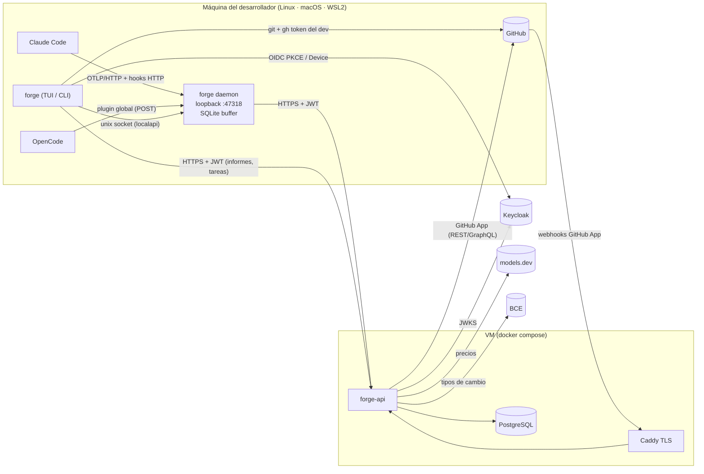
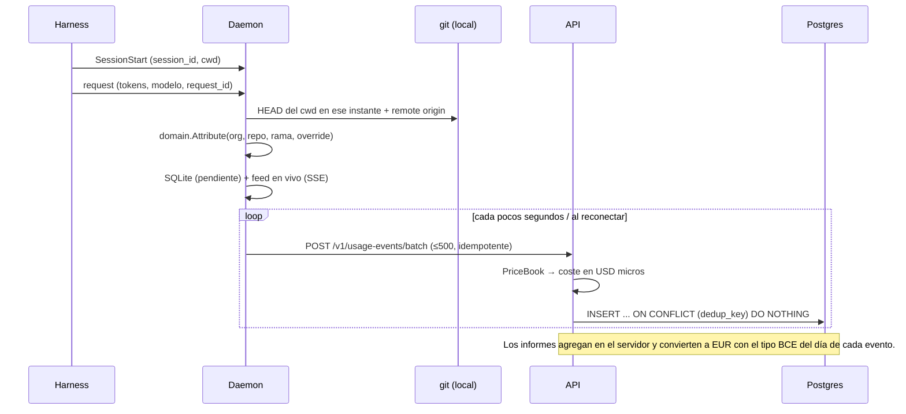
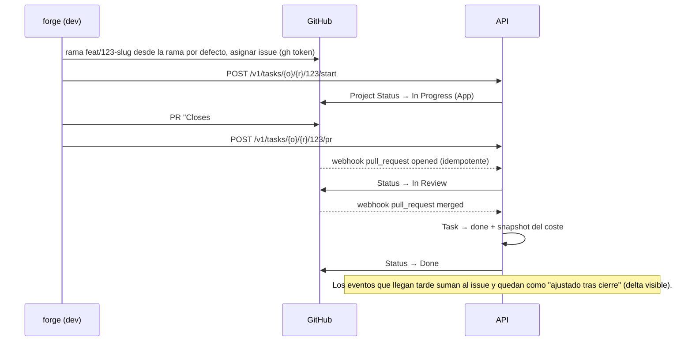

# Arquitectura

forge relaciona el gasto en IA de los harnesses (Claude Code, OpenCode) con el trabajo en GitHub, a nivel de **repo → issue**. Así se puede imputar y consultar ese gasto con una trazabilidad simple.

## Componentes



| Componente | Binario | Responsabilidad |
|---|---|---|
| **CLI** | `forge` | `login`, `setup`, `doctor`, `start`, `pr`, `status`, `daemon install`, `update`. |
| **TUI** | `forge` / `forge tui` | Mis tareas, sesión en vivo, bandeja sin asignar, informes. |
| **Daemon** | `forge daemon run` | Captura la telemetría de los harnesses, atribuye cada request, guarda un buffer offline, sincroniza con la API, sirve `localapi` y es el dueño del refresh token. |
| **API** | `forge-api` | Ingesta idempotente, precios, reportes, ciclo de vida, integración con la GitHub App y webhooks. |

## Organización del código (hexagonal ligera)

```
cmd/forge        CLI + TUI + daemon (un solo binario)
cmd/forge-api    API
api/             openapi.yaml (fuente de verdad) + config de oapi-codegen
internal/
  domain/        modelo puro: UsageEvent, Attribution, Price/PriceBook, Task, StatusMap
  app/           casos de uso del servidor + puertos (GitHub, PriceSource, FXSource, TokenVerifier, Store)
  api/           código generado (modelos, servidor strict net/http, cliente)
  auth/          contratos de identidad del lado dev (TokenSource, Session)
  harness/       contrato de integración con los harnesses (setup/doctor, Captured, Sink)
  daemon/        daemon + localapi (protocolo daemon ↔ TUI/CLI)
  devflow/       camino start → pr con la identidad del dev
  tui/           Bubble Tea v2
  config/        configuración y rutas del lado dev
  adapters/      claudecode, opencode, github, keycloak, postgres, sqlite, modelsdev, ecb, http...
```

Reglas:

- `domain` no importa nada del proyecto.
- `app` solo importa `domain`.
- Los adapters implementan los puertos.
- Solo se definen puertos donde hay un límite externo real.
- El contrato HTTP es **OpenAPI-first**: `go generate ./internal/api`, y la CI falla si el código generado no coincide con la spec.

## Flujo de datos: captura → atribución → sincronización → informes



- **Claude Code**: el daemon actúa como receptor OTLP. Los eventos `claude_code.api_request` son la fuente principal. Un hook HTTP en `SessionStart` relaciona cada `session_id` con su `cwd`. Los transcripts JSONL se usan para reconciliar, deduplicando por `message.id + requestId`.
- **OpenCode**: un plugin global envía `message.updated` cuando el mensaje del asistente se completa. Su base de datos SQLite solo se usa para reconciliar.
- **Atribución**: el override manual siempre gana. Fuera de un repo de la org, el evento es `external` y no guarda datos del repo. Si la rama sigue la convención `<tipo>/<issue>-<slug>`, se asigna al issue. Si no, va al bucket `repo`. Los buckets `repo` y `external` forman la bandeja de gasto sin asignar.
- **Privacidad**: solo se envían metadatos. Nunca prompts, respuestas, código ni rutas.

## Ciclo de vida: start → pr → merge



## Autenticación

```mermaid
sequenceDiagram
  participant CLI as forge login
  participant B as Navegador
  participant KC as Keycloak
  participant D as Daemon
  participant A as API
  CLI->>CLI: listener en 127.0.0.1:<puerto aleatorio>/callback + PKCE S256
  CLI->>B: abrir authorize URL
  B->>KC: login (SSO corporativo)
  KC->>CLI: redirect con code
  CLI->>KC: code + code_verifier → tokens (offline_access)
  CLI->>CLI: refresh token → keyring del SO (o fichero 0600)
  CLI->>D: POST /v1/credentials/reload
  CLI->>A: PUT /v1/me/github-link (token gh, no se guarda)
  D->>KC: refresh (solo lo hace el daemon; rotación activada)
  D->>A: Bearer access token
```

- Sin navegador (SSH, contenedores) se usa el **Device Authorization Grant**, también con PKCE, porque Keycloak lo exige si el client tiene `S256`.
- La API es un *resource server*: valida el JWT por JWKS y comprueba `iss`, `aud=forge-api` y la expiración. Los roles salen de `resource_access.forge-api.roles` (`member` y `admin`).
- La configuración del realm está en [keycloak.md](keycloak.md).

## Registro de decisiones

Decisiones tomadas en la sesión de diseño:

| # | Decisión |
|---|---|
| Q1 | Imputación **repo → issue**. Sin entidad cliente. |
| Q2 | Atribución por **rama**, con override manual y **bandeja sin asignar**. |
| Q3 | Ciclo de vida **opinionated mínimo**: start, pr y merge, sin sustituir a GitHub. |
| Q4 | **Un evento por request**, idempotente; los agregados se calculan en el servidor. |
| Q5 | Todo se paga por uso (Claude Code Enterprise, Copilot Enterprise, LiteLLM con API key). **Los tokens son la verdad.** |
| Q6 | v1: **Claude Code y OpenCode**. Copilot queda fuera (sin atribución por request en local). |
| Q7 | Topología: API central, daemon por máquina y TUI. CLI, TUI y daemon en un solo binario. |
| Q8 | **PostgreSQL** en la API y **SQLite** (modernc, sin CGO) en el daemon. |
| Q9 | Keycloak: **Auth Code + PKCE con loopback** y Device Grant como alternativa. Refresh token en el keyring y validación por JWKS. Gestionáis vosotros el realm. |
| Q10 | **GitHub App** para sincronización y webhooks, más el **token de `gh` del dev** para las acciones con su autoría. Una sola org (`hiberus-industria`). |
| Q11 | Solo **metadatos**. |
| Q12/Q31 | **Todo visible para todos.** Roles `member` y `admin`. |
| Q13 | Hexagonal ligera, OpenAPI-first (oapi-codegen) y `net/http` estándar. |
| Q14 | La API se despliega en una **VM con Docker Compose**. |
| Q15 | Sin etiqueta de cliente. |
| Q16 | Ramas `<tipo>/<issue>-<slug>`. |
| Q17 | La rama se lee del **HEAD en el momento de cada evento**. Sin wrapper. |
| Q18 | `forge setup` muestra el diff antes de aplicar, es idempotente y reversible. `forge doctor` verifica la captura. |
| Q19 | Precios de **models.dev** más overrides manuales, en tabla versionada. |
| Q19b/Q27 | Se guarda en **USD** y se muestra también en **EUR** con el tipo diario del **BCE**. |
| Q20 | Bandeja con reglas: nada se descarta. |
| Q21 | Reasigna el **dueño del evento o un admin**, con log de auditoría. |
| Q22/Q26 | **Un Project por repo**. Los statuses se autodetectan y el admin puede corregirlos. |
| Q23 | Al cerrar se guarda un **snapshot del coste**, que se puede recalcular. Lo que llega después queda como ajuste. |
| Q24 | Vínculo Keycloak ↔ GitHub en `forge login`, verificado por la API. |
| Q25 | Entornos: **Linux, macOS y WSL2**. |
| Q28 | TUI v1: mis tareas con start/pr, sesión en vivo, bandeja e informes. |
| Q29 | Presupuestos y alertas quedan para **v2**. |
| Q30 | VM con **HTTPS público**, para recibir webhooks. |
| Q32 | Distribución con **`install.sh`** (releases de GoReleaser). |
| Q33 | Estética: estilo Charm con paleta corporativa. |
| Q34 | Nombre: **forge**. |
| Q35 | Paleta provisional y configurable. |
| Q36 | Webhooks más reconciliación periódica, CI en GitHub Actions, testcontainers, goose, slog y retención indefinida. |
